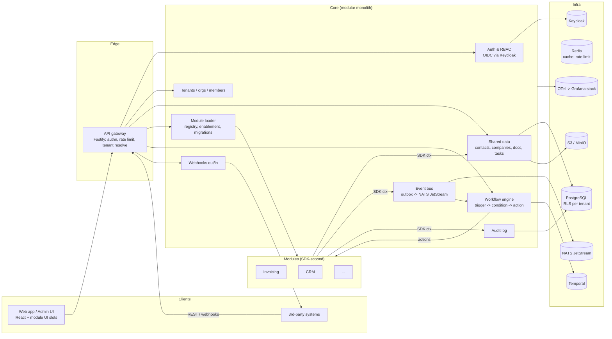

# Office — Architecture

Modular business-automation platform. Small core + per-tenant toggleable modules.

## 1. Diagram



Request path: client -> gateway (JWT verify, resolve tenant, set `app.tenant_id` on DB session) -> core/module handler -> Postgres (RLS enforces tenant) -> outbox row in same tx -> relay publishes to NATS -> workflow engine + webhook dispatcher + module subscribers.

## 2. Stack

| Layer | Choice | Reason |
|---|---|---|
| Language | TypeScript (Node 22 LTS) everywhere | One language for core, modules, UI, SDK types |
| Monorepo | pnpm workspaces + Turborepo | Fast installs, cached builds, module packages |
| API server | Fastify + Zod + `@fastify/swagger` | Fast, schema-first, OpenAPI generated from Zod |
| DB | PostgreSQL 16 | Proven, JSONB, row-level security for tenancy |
| ORM / migrations | Drizzle ORM + drizzle-kit | Typed SQL, explicit migrations per module |
| Tenancy isolation | Postgres RLS on `tenant_id` | Defense in depth beyond app-level filtering |
| Identity | Keycloak (OIDC) | SSO, MFA, SAML, social login without building it |
| Authz | Own RBAC + permission strings (CASL for checks) | Module-declared permissions, tenant-defined roles |
| Event bus | Transactional outbox + NATS JetStream | No lost events, durable consumers, replay |
| Workflows | Temporal | Durable retries, timers, long waits; proven at scale |
| Jobs / cache | Redis 7 (+ BullMQ for light jobs) | Rate limits, sessions cache, simple queues |
| Files | S3 API (MinIO self-host) | Portable object storage, presigned uploads |
| Search | Postgres FTS (v1) -> OpenSearch (later) | Avoid extra infra until needed |
| Frontend | React 19 + Vite + TanStack Router/Query | SPA, typed routing, cache-aware data |
| Design system | Tailwind + shadcn/ui (Radix) | Accessible primitives, owned components |
| Module UI | Build-time slot registry (v1); sandboxed iframe for 3rd-party (v2) | Simple + safe; untrusted code never in main bundle |
| AI | Provider-agnostic `ai` interface, default Anthropic Claude | Swappable LLM, per-tenant keys/limits |
| Email | SMTP out, IMAP/Gmail/Graph in via adapters | Works with any mailbox |
| PDF / e-sign | pdf-lib + SHA-256 hash chain in audit log | No vendor lock; tamper evidence |
| Observability | OpenTelemetry -> Prometheus, Loki, Tempo, Grafana | Open standard traces/metrics/logs |
| Secrets | Env + SOPS (dev), Vault/cloud KMS (prod) | Encrypted at rest, rotatable |
| Testing | Vitest, Testcontainers, Playwright | Real Postgres/NATS in tests, E2E UI |
| Deploy | Docker images, Helm on Kubernetes; docker-compose for dev | Horizontal scaling, one-command local |
| CI | GitHub Actions: lint, typecheck, test, SBOM, Trivy | Supply-chain and vuln gating |

## 3. Core data model

All tenant tables: `id uuid v7 PK`, `tenant_id uuid NOT NULL` (RLS), `created_at`, `updated_at`, `created_by`, `deleted_at` (soft delete). Custom fields in `custom jsonb` validated by tenant schema.

```sql
-- Identity & tenancy (global, no RLS)
tenants(id, slug UNIQUE, name, plan, region, status, settings jsonb)
users(id, idp_subject UNIQUE, email UNIQUE, name, locale, tz, status)
memberships(id, tenant_id, user_id, status, UNIQUE(tenant_id,user_id))
api_keys(id, tenant_id, name, hash, scopes text[], expires_at, last_used_at)

-- RBAC (tenant)
roles(id, tenant_id, key, name, system bool)            -- owner, admin, member, viewer
role_permissions(role_id, permission text)              -- "invoicing:invoice.write"
member_roles(membership_id, role_id)

-- Modules (tenant)
modules(key PK, version, manifest jsonb)                -- registry, global
tenant_modules(tenant_id, module_key, enabled, version, settings jsonb, enabled_at, enabled_by)

-- Shared data (tenant)
companies(id, tenant_id, name, domain, tax_id, address jsonb, custom jsonb)
contacts(id, tenant_id, company_id NULL, first_name, last_name, email, phone, custom jsonb)
documents(id, tenant_id, title, storage_key, mime, size, sha256, owner_id, folder_id)
tasks(id, tenant_id, title, status, due_at, assignee_id, priority)
links(id, tenant_id, from_type, from_id, to_type, to_id, rel)  -- polymorphic relations
tags(id, tenant_id, name) / taggings(tag_id, entity_type, entity_id)
notes(id, tenant_id, entity_type, entity_id, body, author_id)

-- Events & automation (tenant)
outbox(id, tenant_id, type, version, payload jsonb, occurred_at, published_at NULL)
workflows(id, tenant_id, name, enabled, trigger jsonb, conditions jsonb, actions jsonb, version)
workflow_runs(id, tenant_id, workflow_id, event_id, temporal_run_id, status, error, started_at, ended_at)

-- Integration (tenant)
webhook_endpoints(id, tenant_id, url, secret_enc, events text[], active)
webhook_deliveries(id, tenant_id, endpoint_id, event_id, attempt, status_code, next_retry_at)

-- Audit (tenant, append-only: INSERT only grant, hash chained)
audit_log(id, tenant_id, actor_type, actor_id, action, entity_type, entity_id,
          diff jsonb, ip inet, user_agent, request_id, prev_hash, hash, at)
```

Module tables: prefixed `<module>_` (e.g. `invoicing_invoices`), same base columns + RLS, own migrations. Modules reference shared entities by FK; never alter core tables.

## 4. Module SDK spec

Package `@office/sdk`. A module = workspace package at `modules/<name>` exporting a manifest + `defineModule()`.

### 4.1 Manifest (`module.json`, validated by Zod)

| Field | Meaning |
|---|---|
| `key`, `name`, `version` (semver), `description` | Identity |
| `office` | Compatible core range, e.g. `^1.0` |
| `dependsOn` | Other module keys required |
| `permissions.declares` | Permissions this module defines (shown in role editor) |
| `permissions.requires` | Core scopes it needs (`core:contacts.read`, ...); admin grants on enable |
| `entities` | Tables/entities it owns (for API, search, audit) |
| `events.emits` | Event types + JSON schema refs |
| `events.subscribes` | Event types it consumes |
| `workflow.triggers` / `workflow.actions` | Items exposed to the workflow builder, with input schemas |
| `ui.slots` | Where UI mounts (see slots) |
| `settings` | JSON Schema for tenant settings; secrets marked `"x-secret": true` |
| `api.basePath` | Routes mount under `/api/v1/m/<key>` |
| `lifecycle` | Hooks: `install`, `enable`, `disable`, `upgrade`, `uninstall` |

### 4.2 Runtime contract (as built, `@office/sdk`)

```ts
export default defineModule({
  manifest,                                         // validated (Zod) + cross-checked against code below
  migrationsDir: fileURLToPath(new URL("./migrations", import.meta.url)),
  routes: [route({ method: "POST", path: "/invoices", permission: "invoicing:invoice.write",
                   body: z.object({...}), status: 201, handler: async (ctx, { body }) => ({...}) })],
  handlers: { "crm.deal.won": async (ctx, event) => {} },        // must equal events.subscribes
  actions:  { "invoicing.create_invoice": action({ label, input: z.object({...}), run: async (ctx, input) => ({ id }) }) },
  lifecycle: { enable: async (ctx) => {}, disable: async (ctx) => {} },
  jobs: { "mark-overdue": { everySeconds: 3600, run: async (ctx) => 0 } },   // per-tenant schedule (Session 5)
});
```
- Route handlers may return `file({ contentType, filename, body })` for downloads and throw `ModuleError` / `moduleErrors.*` for 4xx problems.
- `defineModule` throws if handlers ≠ `subscribes`, actions ≠ `workflow.actions`, or a route uses an undeclared permission.
- Manifest rules: declared permissions start `<key>:`, emitted events start `<key>.`, triggers ⊆ emits.
- Register built-ins in `packages/modules/src/index.ts` (`MODULES`); api, worker and installer share it.

`ctx` (only door to the platform; scoped to tenant + granted permissions):
- `ctx.tenant`, `ctx.actor`, `ctx.requestId`
- `ctx.db` — Drizzle tx, RLS-bound, module tables + granted core tables only
- `ctx.data.contacts|companies|documents|tasks` — typed core repos
- `ctx.events.emit(type, payload)` — writes to outbox in same tx; type must be in `emits`
- `ctx.authz.require(perm)`
- `ctx.audit.log(action, entity, diff)` (auto for writes via repos)
- `ctx.settings.get()` / `ctx.secrets.get(key)`
- `ctx.files.put|get|presign`
- `ctx.ai.complete|summarize` (metered per tenant)
- `ctx.log`, `ctx.metrics`

### 4.3 Rules
- Event names: `<module>.<entity>.<verb_past>` (`invoicing.invoice.paid`), versioned payload `{v:1,...}`; breaking change = new version.
- Disabled module: routes 404, handlers skipped, UI slots hidden, data retained.
- No cross-module imports. Talk via events, workflow actions, or declared public API.
- Each module: own migrations, README, tests, seed data.
- Core-only operations (tenants, roles, billing) not reachable from `ctx`.

### 4.4 UI slots
`nav.main`, `nav.settings`, `page` (route), `entity.tab:<type>` (e.g. tab on contact), `entity.action:<type>`, `entity.sidebar:<type>`, `dashboard.widget`, `global.create` (+ New menu), `command.palette`.

### 4.5 Example manifest (Session 1 sketch; as built: `modules/invoicing/src/index.ts`)

```json
{
  "key": "invoicing",
  "name": "Invoicing",
  "version": "1.0.0",
  "office": "^1.0",
  "description": "Quotes, invoices, payments, reminders.",
  "dependsOn": [],
  "permissions": {
    "declares": [
      { "key": "invoicing:invoice.read",  "label": "View invoices" },
      { "key": "invoicing:invoice.write", "label": "Create and edit invoices" },
      { "key": "invoicing:invoice.send",  "label": "Send invoices" },
      { "key": "invoicing:settings.manage", "label": "Manage invoicing settings" }
    ],
    "requires": ["core:contacts.read", "core:companies.read", "core:documents.write"]
  },
  "entities": ["invoice", "invoice_line", "payment"],
  "events": {
    "emits": [
      { "type": "invoicing.invoice.created", "schema": "./schemas/invoice.created.v1.json" },
      { "type": "invoicing.invoice.sent",    "schema": "./schemas/invoice.sent.v1.json" },
      { "type": "invoicing.invoice.paid",    "schema": "./schemas/invoice.paid.v1.json" },
      { "type": "invoicing.invoice.overdue", "schema": "./schemas/invoice.overdue.v1.json" }
    ],
    "subscribes": ["crm.deal.won"]
  },
  "workflow": {
    "triggers": ["invoicing.invoice.paid", "invoicing.invoice.overdue"],
    "actions": [
      { "key": "invoicing.create_invoice", "input": "./schemas/action.create_invoice.json" },
      { "key": "invoicing.send_reminder",  "input": "./schemas/action.send_reminder.json" }
    ]
  },
  "ui": {
    "slots": [
      { "slot": "nav.main", "label": "Invoices", "icon": "receipt", "route": "/invoices", "permission": "invoicing:invoice.read" },
      { "slot": "entity.tab:company", "label": "Invoices", "component": "CompanyInvoicesTab" },
      { "slot": "dashboard.widget", "component": "OutstandingWidget" },
      { "slot": "global.create", "label": "Invoice", "route": "/invoices/new", "permission": "invoicing:invoice.write" }
    ]
  },
  "settings": {
    "type": "object",
    "properties": {
      "currency":        { "type": "string", "default": "EUR" },
      "numberFormat":    { "type": "string", "default": "INV-{YYYY}-{seq:5}" },
      "paymentTermDays": { "type": "integer", "default": 30, "minimum": 0 },
      "stripeSecretKey": { "type": "string", "x-secret": true }
    }
  },
  "api": { "basePath": "/invoicing" },
  "lifecycle": ["install", "enable", "disable", "upgrade"]
}
```

## 5. Workflow engine (as built)

- Workflow = `trigger.event` -> `conditions` (JSONLogic over `{event, payload}`) -> `actions[]` (≤50; core + module actions; inputs use `{{payload.x}}`, `{{event.type}}`, `{{steps.N.field}}`; path lookup only, no code).
- Validated on save: trigger must be a known event (core list + module emits), action keys must exist, JSONLogic must parse.
- Dispatcher matches enabled workflows per event and inserts `workflow_runs` (unique per workflow+event) with a `plan` snapshot, then starts a runner after commit.
- Runners: `TemporalRunner` (workflow id `office-run-<runId>`, activity per step, retries 8x exp. backoff, durable `core.wait`) when `TEMPORAL_ADDRESS` set; `InlineRunner` otherwise (3 tries/step, no `core.wait`).
- Steps are idempotent: each runs in its own tenant tx and is skipped if already recorded as succeeded.
- Actions run as actor `system` id `workflow:<id>`; module actions only if the module is enabled; module data access still limited by manifest `requires`.
- Core actions: `core.create_task`, `core.update_record`, `core.notify` (emits `core.notification.requested`), `core.http_request` (SSRF-guarded), `core.wait`. Planned: `send_email`, `branch`, `ai_summarize`.
- Loop guard: event `depth` +1 per hop, max 8; deeper emits fail the run.
- Recovery: worker restarts runs still `pending` after 5 min.

## 5b. Webhooks (as built)

- Endpoints: URL (https in prod; no credentials; private/metadata IPs rejected), event patterns (`type`, `mod.entity.*`, `mod.*`, `*`). Signing secret `whsec_…` shown once, sealed (AES-256-GCM, tenant-bound AAD).
- Dispatcher queues one `webhook_deliveries` row per matching endpoint (unique per endpoint+event).
- Delivery worker: lease-claims due rows (SKIP LOCKED), POSTs envelope with `Office-Event-Id`, `Office-Event-Type`, `Office-Signature: t=<unix>,v1=<hex HMAC-SHA256(secret, "t.body")>`. Connect-time IP check defeats DNS rebinding; no redirects; 5s connect / 10s response timeouts.
- Retries: 12 attempts, backoff 30s doubling to 6h; then `failed`. Endpoint auto-disabled after 50 consecutive failures. Manual redeliver endpoint.
- Inbound webhooks: not built (later, per module).

## 6. Security defaults

- Tenant isolation: RLS (FORCE, applies to table owner too) on every tenant table; app role without BYPASSRLS; intra-tenant FKs are composite `(tenant_id, id)` so rows can't point at another tenant; tests assert cross-tenant reads/writes fail.
- Deny by default: every `/api` route must declare `config.auth` or the server refuses to start; permission checked per route or in the core service.
- OIDC + MFA via Keycloak; API keys `ok_<id>_<secret>` (256-bit), stored as HMAC-SHA256(pepper), scoped, expiring, revocable; a key can't hold more than its creator.
- Secrets encrypted with envelope encryption (KMS); never returned by API.
- Webhooks: HMAC-SHA256 signature + timestamp, replay window 5 min; outbound SSRF guard (block private ranges).
- Input validation with Zod at every boundary; output DTOs (no raw rows).
- Audit: every write + auth event; append-only, hash-chained.
- Rate limits per tenant + per key (Redis). CSP, HSTS, secure cookies.
- Supply chain: lockfile, Renovate, SBOM, Trivy, signed images.
- GDPR: per-tenant export + delete jobs; region field on tenant.

## 7. Scaling

- Stateless API pods behind LB; horizontal autoscale.
- Postgres: pooled (PgBouncer), read replicas; large tenants -> dedicated DB via `tenants.region`/shard map (later).
- NATS consumers + Temporal workers scale independently.
- Modular monolith first; any module can split into its own service later because it only talks via ctx/events/API.

## 8. API

- REST, `/api/v1`, JSON, OpenAPI 3.1 generated; cursor pagination; `Idempotency-Key` header on POST.
- Core: `/tenants`, `/members`, `/roles`, `/modules`, `/contacts`, `/companies`, `/documents`, `/tasks`, `/workflows`, `/webhooks`, `/audit`.
- Modules: `/api/v1/m/<key>/...`.
- Errors: RFC 9457 problem+json.

## 9. Folder structure

```
office/
├─ PLAN.md
├─ ARCHITECTURE.md
├─ package.json / pnpm-workspace.yaml / turbo.json
├─ apps/
│  ├─ api/            # Fastify server: gateway, core routes, module mounting
│  ├─ worker/         # Outbox relay, NATS consumers, Temporal workers, webhooks
│  └─ web/            # React SPA: shell, admin UI, slot host
├─ packages/
│  ├─ ui/             # design system (Session 4)
│  ├─ sdk/ platform/ modules/   # module SDK, platform services, built-in module list (Session 3)
│  ├─ core/           # domain: tenants, rbac, data, audit, events, workflows
│  ├─ db/             # Drizzle schema, migrations, RLS policies
│  ├─ sdk/            # @office/sdk: defineModule, ctx types, manifest schema
│  ├─ ui/             # design system (shadcn-based)
│  ├─ config/         # eslint, tsconfig, tailwind presets
│  └─ testing/        # testcontainers, fixtures, tenant factories
├─ modules/
│  ├─ invoicing/
│  │  ├─ README.md
│  │  ├─ module.json
│  │  ├─ src/{index.ts, routes/, handlers/, actions/, db/schema.ts}
│  │  ├─ migrations/
│  │  ├─ schemas/      # event + action JSON schemas
│  │  ├─ ui/           # slot components
│  │  └─ tests/
│  ├─ expenses/ crm/ scheduling/ support-inbox/ hr/
│  └─ inventory/ docs-esign/ ai-summaries/ kpi-dashboard/
├─ infra/
│  ├─ docker-compose.yml   # pg, redis, nats, temporal, keycloak, minio, grafana
│  ├─ helm/
│  └─ keycloak/realm.json
└─ .github/workflows/
```

## 10. Implementation notes (Session 2, as built)

- DB roles: `office_owner` (migrations), `office_app` (API; NOBYPASSRLS), `office_relay` (worker; BYPASSRLS but only granted `outbox`).
- `withTenant(db, tenantId, fn)`: tx + `set_config('app.tenant_id', id, true)`; policies use `app_tenant_id()`. Pool-safe.
- SQL migrations in `packages/db/migrations/*.sql` are source of truth; Drizzle schema mirrors them. Runner: advisory lock, one tx per file, `_migrations` table.
- Tenant selection: users send `X-Tenant-Id`; API keys are bound to one tenant. Non-members get 404 (no existence leak).
- Users: JIT-provisioned from OIDC claims (`sub`, `email`, `email_verified`). Members added by email only if user signed in once (email invites: later).
- System roles seeded per tenant: owner (`*`), admin, member, viewer. Grants support `*`, `<module>:*`, exact. Last owner cannot be removed/demoted.
- Audit: `seq` + `hash = sha256(prev_hash || row)` computed by DB trigger under per-tenant advisory lock; `audit_verify()` returns first broken seq. App role: INSERT/SELECT only.
- Events: `core.<entity>.<created|updated|deleted>`, `core.tenant.created`, `core.member.added|removed`. Envelope: `{id, tenantId, type, version, payload, actor, causationId, correlationId, depth, occurredAt}`; depth ≤ 8 (loop guard).
- NATS: stream `OFFICE_EVENTS`, subjects `office.<tenantId>.<type>`, 7-day retention, 10-min dedupe window on msgId = event id.
- API: `/api/v1/{me,tenants,tenant,members,roles,permissions,api-keys,audit,audit/verify,contacts,companies,documents,tasks}`; OpenAPI at `/docs`. Lists: `?limit&cursor&q` (cursor = last uuidv7 id; `q` = Postgres FTS on contacts/companies).
- Errors: RFC 9457; PG 23505→409, 23503→400 `invalid_reference`, 23514→400.
- Not yet built: document file upload/presign (S3), Redis-backed rate limit (in-memory now), email invites, GDPR export/delete.

## 11. Implementation notes (Session 3, as built)

- Packages: `@office/sdk` (manifest schema, `defineModule`, `route`, `action`, ctx types), `@office/platform` (registry, installer, module ctx, tenant module mgmt, dispatcher, workflows, webhooks, SSRF guard, SecretBox), `@office/modules` (built-in list + `pnpm modules:install`).
- Install (owner role, deploy time): module migrations namespaced `module:<key>/<file>` in `_migrations`; installer refuses any `<prefix>_*` table lacking `tenant_id` + forced RLS + policy; upserts `modules` registry.
- Enable: deps must be enabled; settings must validate (ajv, JSON Schema 2020-12, defaults applied); admin role gets the module's declared permissions; `lifecycle.enable` runs; audit + `core.module.enabled`. Disable blocked while enabled dependents exist; data kept.
- Settings: `PATCH /modules/:key/settings` merges; `x-secret` fields sealed into `tenant_modules.secrets`, never returned (`secretsSet` lists names); `null` clears.
- Module routes: `/api/v1/m/<key><path>`; 404 unless enabled for the tenant; route permission enforced before handler.
- Module ctx: `ctx.data.*` needs permission in manifest `requires` AND caller grants; `ctx.events.emit` only declared types; audit actions prefixed `<key>.`.
- Dispatcher (worker, NATS durable consumer `dispatcher`): per consumer (`module:<key>`, `workflows`, `webhooks`) one tenant tx + `event_consumptions` row => effectively-once; a failing consumer naks the message, finished consumers skip on redelivery.
- Worker loops: outbox relay, NATS dispatcher, webhook delivery, stale-run sweep, optional Temporal worker.
- `office_relay` role is now the cross-tenant worker role: outbox, webhook delivery columns, stale-run sweep columns only.
- New permissions: `core:workflows.read|manage`, `core:webhooks.manage` (admin by default).
- API: `/modules`, `/modules/:key/{enable,disable,settings}`, `/workflow-catalog`, `/workflows[/:id[/runs]]`, `/webhooks[/:id[/deliveries[/:did/redeliver]]]`, `/m/<key>/*`.
- Not yet: per-module DB roles (modules share `office_app` within tenant RLS; v2 hardening), Temporal path not integration-tested (needs Temporal server), inbound webhooks, email action.

## 12. Frontend (Session 4, as built)

- `packages/ui`: design system. Tailwind v4 tokens as CSS variables (`--bg`, `--surface`, `--fg`, `--primary`, …) with light/dark (`prefers-color-scheme` + `data-theme` override). Components: Button (cva variants), Input/Textarea/Select/Label/Field (a11y-wired), Card, PageHeader, Badge, EmptyState, Spinner, Alert, Table, Dialog + Switch (Radix).
- `apps/web`: React 19 + Vite 6 + TanStack Router (code-based routes) + TanStack Query. Routes: `/`, `/contacts[/:id]`, `/admin/{modules,members,roles,api-keys,workflows[/:id],webhooks,audit}`, `/m/<key>/*`, `/auth/callback`, `/new-organization`.
- Auth: OIDC Authorization Code + PKCE via `oidc-client-ts` (Keycloak client `office-web`); tokens in sessionStorage, silent refresh. E2E builds (`--mode e2e`) swap in an injected-token auth; production bundles don't contain it (checked).
- Tenant: selected org id in localStorage, sent as `X-Tenant-Id`; header switcher; first sign-in without orgs shows "Create your organization".
- Permissions: `GET /api/v1/me/permissions` drives nav/buttons (UI hiding only; API enforces).
- Module UI: build-time `MODULE_UI` registry (`apps/web/src/modules/registry.ts`): `components` (names from manifest `ui.slots[].component`) and `pages` (routes from `nav.main` slots, served at `/m/<key><route>`). Slots render only for enabled modules, permitted users and registered components; each wrapped in an error boundary. Hosts in place: `nav.main`, `dashboard.widget` (home), `entity.tab:contact` (contact page).
- Module settings form generated from manifest JSON Schema (string/number/integer/boolean/enum; `x-secret` write-only).
- Workflow editor: event picker from `/workflow-catalog`, JSONLogic conditions, ordered steps with JSON input prefilled from each action's schema.
- Tests: Vitest + Testing Library (slots, permissions, settings form); Playwright E2E against real API + Postgres + locally signed JWTs (JWKS served by the test harness), desktop + Pixel 7 projects; CI runs both.

## 13. Module SDK additions + Invoicing (Session 5, as built)

- SDK: `jobs` (per-tenant schedules), `file()` responses, `ModuleError`/`moduleErrors`, `@office/sdk/ui` (type-only UI contract: `SlotProps` with `api` (module + core client, `blob` for files), `can`, `navigate`, `subPath`, `errorMessage`).
- Jobs: core table `module_jobs` (migration 0003). Worker loop `module-jobs` (office_relay) seeds rows for tenants with the module enabled, lease-claims due rows (SKIP LOCKED, 10 min lease), runs each as office_app in the tenant (`runModuleJob`), reschedules (`everySeconds`, retry ≤5 min on error). Jobs must be idempotent.
- Web: module pages match the longest registered route; the rest is `subPath` (module-internal routing). `Hosted` wraps every slot/page with host props + error boundary. Tailwind scans `modules/` for module UI classes.
- Module tests import the API harness by relative path (`apps/api/test/harness.ts`) to avoid a workspace dependency cycle.
- Invoicing: see `modules/invoicing/README.md`. Money in integer minor units; gapless per-tenant numbering via sequence row lock in the issuing tx; issued invoices immutable via DB triggers; PDF via pdf-lib (standard fonts, Latin-1 only); `crm.deal.won` v1 payload contract defined here for the CRM session.
