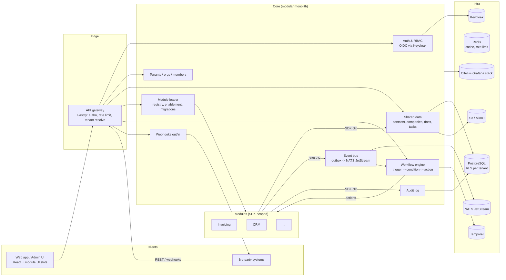

# Office — Architecture

Modular business-automation platform. Small core + per-tenant toggleable modules.

## 1. Diagram



Request path: client -> gateway (JWT verify, resolve tenant, set `app.tenant_id` on DB session) -> core/module handler -> Postgres (RLS enforces tenant) -> outbox row in same tx -> relay publishes to NATS -> workflow engine + webhook dispatcher + module subscribers.

## 2. Stack

| Layer | Choice | Reason |
|---|---|---|
| Language | TypeScript (Node 22 LTS) everywhere | One language for core, modules, UI, SDK types |
| Monorepo | pnpm workspaces + Turborepo | Fast installs, cached builds, module packages |
| API server | Fastify + Zod + `@fastify/swagger` | Fast, schema-first, OpenAPI generated from Zod |
| DB | PostgreSQL 16 | Proven, JSONB, row-level security for tenancy |
| ORM / migrations | Drizzle ORM + drizzle-kit | Typed SQL, explicit migrations per module |
| Tenancy isolation | Postgres RLS on `tenant_id` | Defense in depth beyond app-level filtering |
| Identity | Keycloak (OIDC) | SSO, MFA, SAML, social login without building it |
| Authz | Own RBAC + permission strings (CASL for checks) | Module-declared permissions, tenant-defined roles |
| Event bus | Transactional outbox + NATS JetStream | No lost events, durable consumers, replay |
| Workflows | Temporal | Durable retries, timers, long waits; proven at scale |
| Jobs / cache | Redis 7 (+ BullMQ for light jobs) | Rate limits, sessions cache, simple queues |
| Files | S3 API (MinIO self-host) | Portable object storage, presigned uploads |
| Search | Postgres FTS (v1) -> OpenSearch (later) | Avoid extra infra until needed |
| Frontend | React 19 + Vite + TanStack Router/Query | SPA, typed routing, cache-aware data |
| Design system | Tailwind + shadcn/ui (Radix) | Accessible primitives, owned components |
| Module UI | Build-time slot registry (v1); sandboxed iframe for 3rd-party (v2) | Simple + safe; untrusted code never in main bundle |
| AI | Provider-agnostic `ai` interface, default Anthropic Claude | Swappable LLM, per-tenant keys/limits |
| Email | SMTP out, IMAP/Gmail/Graph in via adapters | Works with any mailbox |
| PDF / e-sign | pdf-lib + SHA-256 hash chain in audit log | No vendor lock; tamper evidence |
| Observability | OpenTelemetry -> Prometheus, Loki, Tempo, Grafana | Open standard traces/metrics/logs |
| Secrets | Env + SOPS (dev), Vault/cloud KMS (prod) | Encrypted at rest, rotatable |
| Testing | Vitest, Testcontainers, Playwright | Real Postgres/NATS in tests, E2E UI |
| Deploy | Docker images, Helm on Kubernetes; docker-compose for dev | Horizontal scaling, one-command local |
| CI | GitHub Actions: lint, typecheck, test, SBOM, Trivy | Supply-chain and vuln gating |

## 3. Core data model

All tenant tables: `id uuid v7 PK`, `tenant_id uuid NOT NULL` (RLS), `created_at`, `updated_at`, `created_by`, `deleted_at` (soft delete). Custom fields in `custom jsonb` validated by tenant schema.

```sql
-- Identity & tenancy (global, no RLS)
tenants(id, slug UNIQUE, name, plan, region, status, settings jsonb)
users(id, idp_subject UNIQUE, email UNIQUE, name, locale, tz, status)
memberships(id, tenant_id, user_id, status, UNIQUE(tenant_id,user_id))
api_keys(id, tenant_id, name, hash, scopes text[], expires_at, last_used_at)

-- RBAC (tenant)
roles(id, tenant_id, key, name, system bool)            -- owner, admin, member, viewer
role_permissions(role_id, permission text)              -- "invoicing:invoice.write"
member_roles(membership_id, role_id)

-- Modules (tenant)
modules(key PK, version, manifest jsonb)                -- registry, global
tenant_modules(tenant_id, module_key, enabled, version, settings jsonb, enabled_at, enabled_by)

-- Shared data (tenant)
companies(id, tenant_id, name, domain, tax_id, address jsonb, custom jsonb)
contacts(id, tenant_id, company_id NULL, first_name, last_name, email, phone, custom jsonb)
documents(id, tenant_id, title, storage_key, mime, size, sha256, owner_id, folder_id)
tasks(id, tenant_id, title, status, due_at, assignee_id, priority)
links(id, tenant_id, from_type, from_id, to_type, to_id, rel)  -- polymorphic relations
tags(id, tenant_id, name) / taggings(tag_id, entity_type, entity_id)
notes(id, tenant_id, entity_type, entity_id, body, author_id)

-- Events & automation (tenant)
outbox(id, tenant_id, type, version, payload jsonb, occurred_at, published_at NULL)
workflows(id, tenant_id, name, enabled, trigger jsonb, conditions jsonb, actions jsonb, version)
workflow_runs(id, tenant_id, workflow_id, event_id, temporal_run_id, status, error, started_at, ended_at)

-- Integration (tenant)
webhook_endpoints(id, tenant_id, url, secret_enc, events text[], active)
webhook_deliveries(id, tenant_id, endpoint_id, event_id, attempt, status_code, next_retry_at)

-- Audit (tenant, append-only: INSERT only grant, hash chained)
audit_log(id, tenant_id, actor_type, actor_id, action, entity_type, entity_id,
          diff jsonb, ip inet, user_agent, request_id, prev_hash, hash, at)
```

Module tables: prefixed `<module>_` (e.g. `invoicing_invoices`), same base columns + RLS, own migrations. Modules reference shared entities by FK; never alter core tables.

## 4. Module SDK spec

Package `@office/sdk`. A module = workspace package at `modules/<name>` exporting a manifest + `defineModule()`.

### 4.1 Manifest (`module.json`, validated by Zod)

| Field | Meaning |
|---|---|
| `key`, `name`, `version` (semver), `description` | Identity |
| `office` | Compatible core range, e.g. `^1.0` |
| `dependsOn` | Other module keys required |
| `permissions.declares` | Permissions this module defines (shown in role editor) |
| `permissions.requires` | Core scopes it needs (`core:contacts.read`, ...); admin grants on enable |
| `entities` | Tables/entities it owns (for API, search, audit) |
| `events.emits` | Event types + JSON schema refs |
| `events.subscribes` | Event types it consumes |
| `workflow.triggers` / `workflow.actions` | Items exposed to the workflow builder, with input schemas |
| `ui.slots` | Where UI mounts (see slots) |
| `settings` | JSON Schema for tenant settings; secrets marked `"x-secret": true` |
| `api.basePath` | Routes mount under `/api/v1/m/<key>` |
| `lifecycle` | Hooks: `install`, `enable`, `disable`, `upgrade`, `uninstall` |

### 4.2 Runtime contract (as built, `@office/sdk`)

```ts
export default defineModule({
  manifest,                                         // validated (Zod) + cross-checked against code below
  migrationsDir: fileURLToPath(new URL("./migrations", import.meta.url)),
  routes: [route({ method: "POST", path: "/invoices", permission: "invoicing:invoice.write",
                   body: z.object({...}), status: 201, handler: async (ctx, { body }) => ({...}) })],
  handlers: { "crm.deal.won": async (ctx, event) => {} },        // must equal events.subscribes
  actions:  { "invoicing.create_invoice": action({ label, permission: "invoicing:invoice.write", input: z.object({...}), run: async (ctx, input) => ({ id }) }) },
  lifecycle: { enable: async (ctx) => {}, disable: async (ctx) => {} },
});
```
- `defineModule` throws if handlers ≠ `subscribes`, actions ≠ `workflow.actions`, or a route uses an undeclared permission.
- Manifest rules: declared permissions start `<key>:`, emitted events start `<key>.`, triggers ⊆ emits.
- Register built-ins in `packages/modules/src/index.ts` (`MODULES`); api, worker and installer share it.
- **Public routes (Session 14):** `publicRoutes: [publicRoute({ method, path, body?, handler: (ctx, { params, body, client: { ip, userAgent } }) => … })]`.
  - Mounted at `/api/v1/public/t/:tenantId/m/<key><path>` with no sign-in, rate-limited to 120 per minute per IP.
  - They run in `withTenant` only for an active tenant with the module turned on; anything else answers the same 404, "This link is not valid".
  - The actor is a system actor (`public:<key>`) with **no permissions**, so the handler must check its own secret (for example a signing token).
  - Paths must match `/^\/[a-z0-9/:_-]*$/i`.
  - The web side: `ModuleUi.publicPages: [{ path, component }]` is served at `/p/:tenantId/<key>/…` outside the signed-in shell. Components get `{ params, path, tenantId, api }`, where `api` is an anonymous client: it sends no token and a 401 doesn't sign anyone out.

- **Errors that keep changes (Session 15):** `throw new ModuleError(status, code, message, { keepChanges: true })` commits the request's transaction, then answers with the error. Use it when something billed or irreversible already happened (for example the AI module logging tokens for a failed Claude call). Without it, any error rolls the transaction back.

- **Metrics (Session 16):** a module publishes numbers with `metrics: [metric({ key: "<module>.<name>", label, description, group, unit, kind: "total" | "snapshot", better, permission, link?, compute(ctx, range) })]`.
  - `defineModule` checks the key prefix (`METRIC_KEY_RE`) and that the permission is declared or required by the module.
  - `range` is a `MetricRange` `{ from, to, start, end, timeZone, current }`: dates for date columns, ISO timestamps for timestamp columns (pass the strings to SQL, not `Date` objects). `metricRange(from, to, tz)` in `@office/sdk` builds one; days start at midnight in `tz`.
  - `compute` returns a number, `{ value, currency }` or `null` (unknown, for example a snapshot asked for a past period).
  - Readers need `core:metrics.read` in `requires`. `ctx.metrics.list({ as?, all? })` lists what the reader may see (`all` also lists the rest, for labels); `ctx.metrics.get(key, range, { as? })` computes one. `as: userId` uses that member's permissions (the KPI digest).
  - Each metric runs as the owning module, in its own savepoint, one at a time; an error gives `{ value: null, error }` and is logged, so one broken number never breaks a board.
  - Core metrics: `core.contacts_new`, `core.tasks_overdue`, `core.members`.
- **`ctx.people.can(userId, permission)`** (Session 16): whether a member has a permission in this tenant.
- `createModuleContext(tx, base, def, state, log?, deps?)`: API routes, jobs, the dispatcher and workflow actions pass `deps` (`{ registry, secrets }`) so `ctx.metrics` can reach other modules.

`ctx` (only door to the platform; scoped to tenant + granted permissions):
- `ctx.tenant`, `ctx.actor`, `ctx.requestId`
- `ctx.db` — Drizzle tx, RLS-bound, module tables + granted core tables only
- `ctx.data.contacts|companies|documents|tasks` — typed core repos
- `ctx.events.emit(type, payload)` — writes to outbox in same tx; type must be in `emits`
- `ctx.authz.require(perm)`
- `ctx.audit.log(action, entity, diff)` (auto for writes via repos)
- `ctx.settings.get()` / `ctx.secrets.get(key)`
- `ctx.files.put|get|presign`
- `ctx.ai.complete|summarize` (metered per tenant)
- `ctx.log`, `ctx.metrics` (list/get, see above), `ctx.people.can`

### 4.3 Rules
- Event names: `<module>.<entity>.<verb_past>` (`invoicing.invoice.paid`), versioned payload `{v:1,...}`; breaking change = new version.
- Disabled module: routes 404, handlers skipped, UI slots hidden, data retained.
- No cross-module imports. Talk via events, workflow actions, or declared public API.
- Each module: own migrations, README, tests, seed data.
- Core-only operations (tenants, roles, billing) not reachable from `ctx`.

### 4.4 UI slots
`nav.main`, `nav.settings`, `page` (route), `entity.tab:<type>` (e.g. tab on contact), `entity.action:<type>`, `entity.sidebar:<type>`, `dashboard.widget`, `global.create` (+ New menu), `command.palette`.

**Slots inside module pages (Session 15):** `ModuleHost.Slot` renders other enabled modules' slot components: `<host.Slot name="entity.sidebar:ticket" entityType="ticket" entityId={id} entity={{…}} />`. Names must match `entity.(tab|action|sidebar):<type>`. `entity` passes plain data the page already has (Support passes the ticket's subject, contact and messages; CRM the deal's title and contact), so modules still never import each other. Renders nothing when no enabled module fills the slot. `ctx.ai` below is not built; the AI module calls Claude itself.

### 4.5 Example manifest

```json
{
  "key": "invoicing",
  "name": "Invoicing",
  "version": "1.0.0",
  "office": "^1.0",
  "description": "Quotes, invoices, payments, reminders.",
  "dependsOn": [],
  "permissions": {
    "declares": [
      { "key": "invoicing:invoice.read",  "label": "View invoices" },
      { "key": "invoicing:invoice.write", "label": "Create and edit invoices" },
      { "key": "invoicing:invoice.send",  "label": "Send invoices" },
      { "key": "invoicing:settings.manage", "label": "Manage invoicing settings" }
    ],
    "requires": ["core:contacts.read", "core:companies.read", "core:documents.write"]
  },
  "entities": ["invoice", "invoice_line", "payment"],
  "events": {
    "emits": [
      { "type": "invoicing.invoice.created", "schema": "./schemas/invoice.created.v1.json" },
      { "type": "invoicing.invoice.sent",    "schema": "./schemas/invoice.sent.v1.json" },
      { "type": "invoicing.invoice.paid",    "schema": "./schemas/invoice.paid.v1.json" },
      { "type": "invoicing.invoice.overdue", "schema": "./schemas/invoice.overdue.v1.json" }
    ],
    "subscribes": ["crm.deal.won"]
  },
  "workflow": {
    "triggers": ["invoicing.invoice.paid", "invoicing.invoice.overdue"],
    "actions": [
      { "key": "invoicing.create_invoice", "input": "./schemas/action.create_invoice.json" },
      { "key": "invoicing.send_reminder",  "input": "./schemas/action.send_reminder.json" }
    ]
  },
  "ui": {
    "slots": [
      { "slot": "nav.main", "label": "Invoices", "icon": "receipt", "route": "/invoices", "permission": "invoicing:invoice.read" },
      { "slot": "entity.tab:company", "label": "Invoices", "component": "CompanyInvoicesTab" },
      { "slot": "dashboard.widget", "component": "OutstandingWidget" },
      { "slot": "global.create", "label": "Invoice", "route": "/invoices/new", "permission": "invoicing:invoice.write" }
    ]
  },
  "settings": {
    "type": "object",
    "properties": {
      "currency":        { "type": "string", "default": "EUR" },
      "numberFormat":    { "type": "string", "default": "INV-{YYYY}-{seq:5}" },
      "paymentTermDays": { "type": "integer", "default": 30, "minimum": 0 },
      "stripeSecretKey": { "type": "string", "x-secret": true }
    }
  },
  "api": { "basePath": "/invoicing" },
  "lifecycle": ["install", "enable", "disable", "upgrade"]
}
```

## 5. Workflow engine (as built)

- Workflow = `trigger.event` -> `conditions` (JSONLogic over `{event, payload}`) -> `actions[]` (≤50; core + module actions; inputs use `{{payload.x}}`, `{{event.type}}`, `{{steps.N.field}}`; path lookup only, no code).
- Validated on save: trigger must be a known event (core list + module emits), action keys must exist, JSONLogic must parse.
- Dispatcher matches enabled workflows per event and inserts `workflow_runs` (unique per workflow+event) with a `plan` snapshot, then starts a runner after commit.
- Runners: `TemporalRunner` (workflow id `office-run-<runId>`, activity per step, retries 8x exp. backoff, durable `core.wait`) when `TEMPORAL_ADDRESS` set; `InlineRunner` otherwise (3 tries/step, no `core.wait`).
- Steps are idempotent: each runs in its own tenant tx and is skipped if already recorded as succeeded.
- Actions run as actor `system` id `workflow:<id>`; module actions only if the module is enabled; module data access still limited by manifest `requires`.
- Core actions: `core.create_task`, `core.update_record`, `core.notify` (emits `core.notification.requested`), `core.http_request` (SSRF-guarded), `core.wait`. Planned: `send_email`, `branch`, `ai_summarize`.
- Loop guard: event `depth` +1 per hop, max 8; deeper emits fail the run.
- Recovery: worker restarts runs still `pending` after 5 min.

## 5b. Webhooks (as built)

- Endpoints: URL (https in prod; no credentials; private/metadata IPs rejected), event patterns (`type`, `mod.entity.*`, `mod.*`, `*`). Signing secret `whsec_…` shown once, sealed (AES-256-GCM, tenant-bound AAD).
- Dispatcher queues one `webhook_deliveries` row per matching endpoint (unique per endpoint+event).
- Delivery worker: lease-claims due rows (SKIP LOCKED), POSTs envelope with `Office-Event-Id`, `Office-Event-Type`, `Office-Signature: t=<unix>,v1=<hex HMAC-SHA256(secret, "t.body")>`. Connect-time IP check defeats DNS rebinding; no redirects; 5s connect / 10s response timeouts.
- Retries: 12 attempts, backoff 30s doubling to 6h; then `failed`. Endpoint auto-disabled after 50 consecutive failures. Manual redeliver endpoint.
- Inbound webhooks: not built (later, per module).

## 6. Security defaults

- Tenant isolation: RLS (FORCE, applies to table owner too) on every tenant table; app role without BYPASSRLS; intra-tenant FKs are composite `(tenant_id, id)` so rows can't point at another tenant; tests assert cross-tenant reads/writes fail.
- Deny by default: every `/api` route must declare `config.auth` or the server refuses to start; permission checked per route or in the core service.
- OIDC + MFA via Keycloak; API keys `ok_<id>_<secret>` (256-bit), stored as HMAC-SHA256(pepper), scoped, expiring, revocable; a key can't hold more than its creator, checked at creation and again on every request (scopes the creator has lost are dropped, and the key stops working when the creator leaves the tenant).
- Workflows run as a person (Session 19): each workflow runs with the *current* permissions of whoever last saved it (`workflows.run_as`), never with `*`. Every action declares a permission (`action({ permission })`, checked by `defineModule`; core actions: tasks/record write, `core:webhooks.manage` for HTTP requests). Saving needs every step's permission; each step is checked again when it runs, and a run fails if that person lost the permission or left (saving the workflow again makes it run as the new saver). Steps are still audited as `workflow:<id>`.
- Program owner (Session 20, managed in the app since Session 22): businesses are created by program owners (the `platform_admins` table, seeded once from `PLATFORM_ADMIN_EMAILS`; verified email only; owner changes are logged in `platform_audit`; at least one signed-in owner always remains; transfer only to an existing account) unless `SELF_SIGNUP=true`. The program owner is never a member: `/platform/*` returns business names, owner emails, counts and feature keys, read per tenant inside `withTenant`, and nothing else. A new business has no members until its owner accepts the owner invitation (`invitations.by_platform`, which skips the "inviter is still a member" check). Paused tenants (`status = suspended`) keep their data; members get 403 `tenant_paused`, non-members still 404, and `runDueJobs` skips them.
- Program owner viewing (Session 26): `makeTenantRunner` lets a verified program owner who is not a member into any active or paused business with `PROGRAM_OWNER_VIEW` plus every module's `roles.viewer` grants, GET/HEAD only (else 403 `read_only`), actor flagged `viewingAs: "program_owner"` (`/me/access.viewing`). Each visit is audited in that tenant (`tenant.viewed_by_program_owner`, once per 30 min per owner). This supersedes "the program owner is never a member / sees only names and counts" above for reading; the program owner still can't change anything inside a business.
- Features per business (Session 21): `tenants.allowed_modules` (null = all) is set only by program owners. `enableModule` refuses features not included (403 `feature_not_included`); narrowing the list turns off now-excluded modules, dependents first, keeping their data; the allowed list always includes dependencies.
- Invitations (Session 18): nobody joins a tenant without accepting. Invites are for one email address, expire after 7 days, store only SHA-256(token), and are re-checked against the inviter's current permissions on accept. Platform email (`MAIL_SMTP_URL`, `MAIL_FROM`) is operator config; links use `APP_URL`.
- No privilege escalation (Session 17): creating, editing or deleting a role, giving roles, changing a member's roles and removing a member all require the actor to hold every permission involved (old and new). So an admin can't make a `*` role, hand out `core:tenant.manage`, or demote or remove an owner.
- Failed sign-ins are also limited per IP (default 120 a minute, then 429 for the rest of the minute), because the general rate limit is per credential and random fake tokens would each get a fresh bucket. In-memory, per API instance.
- Row locks for public actions: docs signing and declining lock the document row first, so concurrent signers can't leave a request uncompleted.
- Secrets encrypted with envelope encryption (KMS); never returned by API.
- Webhooks: HMAC-SHA256 signature + timestamp, replay window 5 min; outbound SSRF guard (block private ranges).
- Tenant mailboxes (Support module): IMAP/SMTP hosts are tenant input, so `modules/support/src/mail.ts` resolves each host and refuses private/loopback/link-local addresses and unencrypted connections in production (relaxed outside production or with `SUPPORT_ALLOW_PRIVATE_MAIL_HOSTS=true`). Mail passwords are `x-secret` module settings (sealed, never returned).
- Input validation with Zod at every boundary; output DTOs (no raw rows).
- Audit: every write + auth event; append-only, hash-chained.
- Rate limits per tenant + per key (Redis). CSP, HSTS, secure cookies.
- Supply chain: lockfile, Renovate, SBOM, Trivy, signed images.
- GDPR: per-tenant export + delete jobs; region field on tenant.

## 7. Scaling

- Stateless API pods behind LB; horizontal autoscale.
- Postgres: pooled (PgBouncer), read replicas; large tenants -> dedicated DB via `tenants.region`/shard map (later).
- NATS consumers + Temporal workers scale independently.
- Modular monolith first; any module can split into its own service later because it only talks via ctx/events/API.

## 8. API

- REST, `/api/v1`, JSON, OpenAPI 3.1 generated; cursor pagination; `Idempotency-Key` header on POST.
- Core: `/tenants`, `/members`, `/roles`, `/modules`, `/contacts`, `/companies`, `/documents`, `/tasks`, `/workflows`, `/webhooks`, `/audit`.
- Modules: `/api/v1/m/<key>/...`.
- Errors: RFC 9457 problem+json.

## 9. Folder structure

```
office/
├─ PLAN.md
├─ ARCHITECTURE.md
├─ package.json / pnpm-workspace.yaml / turbo.json
├─ apps/
│  ├─ api/            # Fastify server: gateway, core routes, module mounting
│  ├─ worker/         # Outbox relay, NATS consumers, Temporal workers, webhooks
│  └─ web/            # React SPA: shell, admin UI, slot host
├─ packages/
│  ├─ core/           # domain: tenants, rbac, data, audit, events, workflows
│  ├─ db/             # Drizzle schema, migrations, RLS policies
│  ├─ sdk/            # @office/sdk: defineModule, ctx types, manifest schema
│  ├─ ui/             # design system (shadcn-based)
│  ├─ config/         # eslint, tsconfig, tailwind presets
│  └─ testing/        # testcontainers, fixtures, tenant factories
├─ modules/
│  ├─ invoicing/
│  │  ├─ README.md
│  │  ├─ module.json
│  │  ├─ src/{index.ts, routes/, handlers/, actions/, db/schema.ts}
│  │  ├─ migrations/
│  │  ├─ schemas/      # event + action JSON schemas
│  │  ├─ ui/           # slot components
│  │  └─ tests/
│  ├─ expenses/ crm/ leads/ messages/ scheduling/ support/ hr/
│  └─ inventory/ docs-esign/ ai-summaries/ kpi-dashboard/
├─ infra/
│  ├─ docker-compose.yml   # pg, redis, nats, temporal, keycloak, minio, grafana
│  ├─ helm/
│  └─ keycloak/realm.json
└─ .github/workflows/
```

## 10. Implementation notes (Session 2, as built)

- DB roles: `office_owner` (migrations), `office_app` (API; NOBYPASSRLS), `office_relay` (worker; BYPASSRLS but only granted `outbox`).
- `withTenant(db, tenantId, fn)`: tx + `set_config('app.tenant_id', id, true)`; policies use `app_tenant_id()`. Pool-safe.
- SQL migrations in `packages/db/migrations/*.sql` are source of truth; Drizzle schema mirrors them. Runner: advisory lock, one tx per file, `_migrations` table.
- Tenant selection: users send `X-Tenant-Id`; API keys are bound to one tenant. Non-members get 404 (no existence leak).
- Users: JIT-provisioned from OIDC claims (`sub`, `email`, `email_verified`). Members added by email only if user signed in once (email invites: later).
- System roles seeded per tenant: owner (`*`), admin, member, viewer. Grants support `*`, `<module>:*`, exact. Last owner cannot be removed/demoted.
- Audit: `seq` + `hash = sha256(prev_hash || row)` computed by DB trigger under per-tenant advisory lock; `audit_verify()` returns first broken seq. App role: INSERT/SELECT only.
- Events: `core.<entity>.<created|updated|deleted>`, `core.tenant.created`, `core.member.added|removed`. Envelope: `{id, tenantId, type, version, payload, actor, causationId, correlationId, depth, occurredAt}`; depth ≤ 8 (loop guard).
- NATS: stream `OFFICE_EVENTS`, subjects `office.<tenantId>.<type>`, 7-day retention, 10-min dedupe window on msgId = event id.
- API: `/api/v1/{me,tenants,tenant,members,roles,permissions,api-keys,audit,audit/verify,contacts,companies,documents,tasks}`; OpenAPI at `/docs`. Lists: `?limit&cursor&q` (cursor = last uuidv7 id; `q` = Postgres FTS on contacts/companies).
- Errors: RFC 9457; PG 23505→409, 23503→400 `invalid_reference`, 23514→400.
- Not yet built: document file upload/presign (S3), Redis-backed rate limit (in-memory now), email invites, GDPR export/delete.

## 11. Implementation notes (Session 3, as built)

- Packages: `@office/sdk` (manifest schema, `defineModule`, `route`, `action`, ctx types), `@office/platform` (registry, installer, module ctx, tenant module mgmt, dispatcher, workflows, webhooks, SSRF guard, SecretBox), `@office/modules` (built-in list + `pnpm modules:install`).
- Install (owner role, deploy time): module migrations namespaced `module:<key>/<file>` in `_migrations`; installer refuses any `<prefix>_*` table lacking `tenant_id` + forced RLS + policy; upserts `modules` registry.
- Enable: deps must be enabled; settings must validate (ajv, JSON Schema 2020-12, defaults applied); admin role gets the module's declared permissions; `lifecycle.enable` runs; audit + `core.module.enabled`. Disable blocked while enabled dependents exist; data kept.
- Settings: `PATCH /modules/:key/settings` merges; `x-secret` fields sealed into `tenant_modules.secrets`, never returned (`secretsSet` lists names); `null` clears.
- Module routes: `/api/v1/m/<key><path>`; 404 unless enabled for the tenant; route permission enforced before handler.
- Module ctx: `ctx.data.*` needs permission in manifest `requires` AND caller grants; `ctx.events.emit` only declared types; audit actions prefixed `<key>.`.
- Dispatcher (worker, NATS durable consumer `dispatcher`): per consumer (`module:<key>`, `workflows`, `webhooks`) one tenant tx + `event_consumptions` row => effectively-once; a failing consumer naks the message, finished consumers skip on redelivery.
- Worker loops: outbox relay, NATS dispatcher, webhook delivery, stale-run sweep, optional Temporal worker.
- `office_relay` role is now the cross-tenant worker role: outbox, webhook delivery columns, stale-run sweep columns only.
- New permissions: `core:workflows.read|manage`, `core:webhooks.manage` (admin by default).
- API: `/modules`, `/modules/:key/{enable,disable,settings}`, `/workflow-catalog`, `/workflows[/:id[/runs]]`, `/webhooks[/:id[/deliveries[/:did/redeliver]]]`, `/m/<key>/*`.
- Not yet: per-module DB roles (modules share `office_app` within tenant RLS; v2 hardening), Temporal path not integration-tested (needs Temporal server), inbound webhooks, email action.

## 12. Implementation notes (Session 4, as built)

- `apps/web`: React 19 + Vite + TanStack Router/Query + Tailwind 4. Routes: `/` (sign-in), `/onboarding`, `/t/<slug>` (dashboard), contacts/companies/tasks (list, detail, activity tab), workflows (list + builder), settings (members, roles, modules, webhooks, API keys, audit), `/t/<slug>/m/<module>/*` (module pages).
- `@office/ui` design system (shadcn-style on Radix primitives): button, badge, card, input/controls, overlay (dialog, dropdown), feedback (toast, empty/error states), table, `SchemaForm` (renders JSON Schema forms, used for module settings + workflow action inputs). Light/dark theme tokens in `styles.css`.
- Auth: OIDC authorization code + PKCE (S256) via `oidc-client-ts`; tokens in `sessionStorage`, refreshed before expiry. Tenant chosen by URL slug and sent as `x-tenant-id`. Workspace switcher in the shell.
- `GET /api/v1/me/access` (new): tenant, actor, sorted permissions, enabled modules with the UI slots the caller may see. UI gating mirrors `hasPermission`; the API still enforces everything.
- Slot host (`apps/web/src/modules`): build-time registry of module UI packages (`defineModuleUi` contract in `@office/ui/module-ui`) renders `nav.main`, `entity.tab:<type>`, `dashboard.widget`, `global.create` slots for enabled modules only.
- Workflow builder: trigger picker from `/workflow-catalog`, condition rows <-> JSONLogic (falls back to raw "advanced" mode for anything rows cannot show, so no definition is lost), action steps with `{{payload.x}}` templating, runs tab.
- Dev OIDC (`apps/api/scripts/dev-oidc.ts`, `pnpm dev:oidc`): Keycloak-shaped paths, refuses `NODE_ENV=production`. Local dev signs in with email + password (accounts and signing key in git-ignored `.dev-accounts.json`); E2E sets `DEV_OIDC_PASSWORDS=off` so any email signs in. No Docker needed.
- Colleagues: a business owner can create a colleague's account with a starting password (`POST /members/accounts` → `Identity.createAccount`; dev `POST /dev-admin/accounts`, Keycloak a user with a temporary credential). The password passes through the API to the sign-in service and is never stored or logged by Office; the sign-in service makes the person choose their own at first sign-in. Existing accounts are never touched (409 `account_exists`; invite instead).
- Passwords belong to the sign-in service, never to Office. Office only asks it for one-time "set your password" links (`Identity.passwordLink`, `IDP_ADMIN_URL` + `IDP_ADMIN_SECRET`; dev: `POST /dev-admin/password-link` with `x-dev-admin-secret`) and puts them in emails to people who have no password yet. `POST /auth/forgot-password` is public, rate-limited (5 per 15 min) and answers the same for every email.
- Deleting a business is confirmed by typing its name. (A password re-check through the sign-in page was tried and removed; the access token's `auth_time` is still available as Principal `authTime` if a step-up is wanted later.)
- CORS: explicit methods/headers (`x-tenant-id`, `idempotency-key`), preflight cached 10 min.
- Tests: web unit (`apps/web/test`, vitest+jsdom), UI unit (`packages/ui`), full-stack E2E (`apps/web/e2e`, Playwright: real API + Postgres + dev OIDC + Vite; 9 flows). CI runs E2E as its own job.

## 13. Implementation notes (Session 5, as built)

- **Scheduled module jobs (new SDK feature):** `jobs: { key: job({ label, everyMinutes, run(ctx) }) }`. Table `module_job_state` (migration 0003) holds `next_run_at` per tenant+module+job. Worker loop `module-jobs` (every 30 s, `runDueJobs`): as `office_relay` it seeds rows for tenants with the module enabled, claims due rows with SKIP LOCKED and pushes `next_run_at` forward before running; each job then runs in a normal tenant tx as actor `module:<key>`. Jobs must be idempotent. Disabled modules are skipped; errors land in `last_error`.
- **Module errors:** `ModuleError` / `moduleErrors.{badRequest,notFound,conflict}` in `@office/sdk` (modules may not import `@office/core`); the API maps `statusCode` + `code` to problem+json.
- **Core search:** `?q=` now matches whole words/phrases OR word prefixes (`init` finds `Initech`); prefix terms are built from letters/digits only.
- **Invoicing module** (`modules/invoicing`, see its README): tables `invoicing_{invoices,invoice_lines,payments,sequences}` with RLS + composite FKs; company/contact FKs `ON DELETE SET NULL (col)` and a `bill_to` snapshot so issued invoices never change. Gapless numbers via a row-locked per-period counter at send time. Money in integer cents with BigInt per-line rounding shared by API and UI. Events, workflow actions, `crm.deal.won` handler, hourly `mark_overdue` job, UI pages + company/contact tab + dashboard widget.
- **E2E DB prep** now also installs built-in modules (`installModules`).
- **Invoicing details + usability pass:** migration `0002_details` adds `reference`, `service_date`, `seller` (jsonb snapshot taken at finalize). Settings gained logo (raster data URL), structured business address, contact, bank and footer fields, edited on the module's own settings page (`nav.settings` slot; Settings → Modules opens it). UI wording: "Finalize" instead of "Send" (no email is sent), "Awaiting payment" for `sent`.
- **Workflow builder vocabulary** (`apps/web/src/pages/workflows/vocab.ts`): plain-language trigger names and groups, known payload fields per event (condition field picker + click-to-insert `{{payload.x}}` chips), a one-sentence summary, and starter recipes (`/workflows/new?recipe=<id>`, shown only when their trigger exists). Unknown module events fall back to a generated name and a free-text field. Stored definitions are unchanged.

## 14. Implementation notes (Session 6, as built)

- **CRM module** (`modules/crm`, see its README): tables `crm_{pipelines,stages,deals,activities}` with RLS and composite FKs. A deal's `(tenant_id, pipeline_id, stage_id)` references its stage, so the stage always belongs to the deal's pipeline, and stages with deals cannot be deleted (RESTRICT). Status is derived from the stage kind on every move; `closed_at` is set only for won/lost (CHECK). Default pipeline is seeded by `lifecycle.enable` (idempotent; it runs again on re-enable).
- **Module → module:** CRM emits `crm.deal.won` with the payload contract Invoicing already subscribed to; Invoicing dedupes by deal id, so re-winning a deal never creates a second invoice. Neither module imports the other.
- **Leads module** (`modules/leads`, see its README): tables `leads_{leads,activities,forms}` with RLS; contact/company FKs `ON DELETE SET NULL (col)`. Converting goes through `ctx.data` (core contacts/companies, reused by email / name). Leads → CRM works the same way as CRM → Invoicing: `leads.lead.converted` carries an optional `deal`, CRM subscribes and opens it (once per event via the dispatcher's consumption rows); Leads never imports CRM. The public web form is a `publicRoutes` pair keyed by a per-business token (honeypot, per-IP rate limit, off until turned on).
- **Messages module** (`modules/messages`, see its README): tables `messages_{conversations,members,messages,files}` with RLS. Privacy is enforced in the module: every query joins `messages_members` on the caller, so non-members get 404; events carry no message text. Direct chats are unique per pair (`direct_key`). Live updates are polling (`after` id + `since` time); the menu count uses the manifest slot field `badge`.
- **Local worker** (`apps/worker/scripts/dev-local.ts`): runs the outbox relay with an in-process "publisher" that dispatches each event straight to module handlers and workflows (InlineRunner), plus webhook delivery and module jobs, without NATS or Temporal. Used by `pnpm dev:local-worker` and as a Playwright web server (health port 3193). Production keeps `src/main.ts` (JetStream).
- **Workflow vocabulary** gained CRM events, deal fields and two recipes (kick off won deals; open a deal for new companies). Recipes now also require their actions to exist in the catalog.

## 15. Paid sign-up (Session 28, as built)
`apps/api/src/billing.ts` (Stripe Checkout call + webhook signature check, no SDK) and `routes/billing.ts` (`/signup/config`, `/signup/checkout`, `/stripe/webhook`; all public, the webhook keeps its body raw in its own plugin). The webhook is the only thing that creates a business from a payment; it acts as `{ userId: null, email: "stripe" }` through the normal `createBusiness` / `setBusinessStatus`, so audit and owner invitation work as for hand-made businesses. `tenants.stripe_subscription_id` (unique) makes it idempotent and links a subscription to its business.

## 16. Going-live pieces (Session 29, as built)
`apps/api/src/keycloak.ts` implements `Identity` for Keycloak's admin API (service account, client credentials, token cached); `server.ts` picks it over the dev sign-in server when `KEYCLOAK_*` is set. Billing gained `portalUrl` (Stripe customer portal) behind `POST /billing/portal` (needs `core:tenant.manage`) and the checkout requires `acceptTerms`. Legal text lives in the web app (`pages/Legal.tsx`, `legal/company.ts`) because it is public and versioned with the code.
